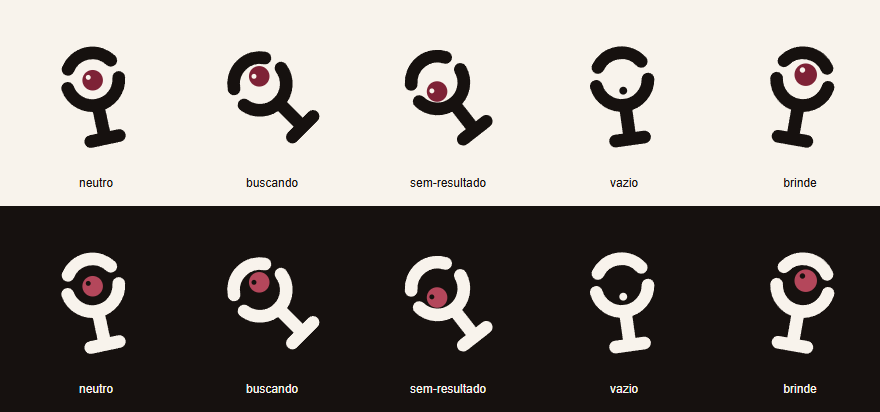

# Mascote taça-lupa

> **Status: suspenso (2026-11-15).** Por decisão do usuário, o app não usa mascote nesta versão; a marca fica só com o logo ([ADR 0006](../decisions/0006-no-mascot.md)). Os arquivos e o gerador ficam no repositório como histórico, caso o mascote volte. O que segue descreve a proposta.

Criado em 2026-11-15 a pedido: "um mascote com a mesma ideia da logo" ([ADR 0005](../decisions/0005-logo-and-mascot.md)). Gerador reproduzível: [`tools/brand/mascot_taca_lupa.py`](../../tools/brand/mascot_taca_lupa.py). Arquivos em [`assets/brand/mascot/taca-lupa/`](../../assets/brand/mascot/taca-lupa/).

## Ideia

A mesma taça-lupa do símbolo, com um olho: **a lente vira o olho e o vinho vira a íris**. O personagem é literalmente quem olha o vinho de perto. Usa as mesmas peças e o mesmo traço do logo, então é reconhecível como parte da marca sem ser o logo.

A expressão vem só de duas coisas: a inclinação do corpo e a direção do olhar. Sem boca, bochecha, braços ou acessórios, para não ficar infantil.

## Poses

| Pose | Arquivo | Quando |
|---|---|---|
| Neutro | `mascote-neutro-{claro,escuro}.svg` | Apresentação, onboarding, sem conexão |
| Buscando | `mascote-buscando-{claro,escuro}.svg` | Antes da primeira busca, busca demorando. Mesma inclinação do símbolo. |
| Sem resultado | `mascote-sem-resultado-{claro,escuro}.svg` | Busca vazia: olha para baixo, de lado |
| Vazio | `mascote-vazio-{claro,escuro}.svg` | Adega vazia: a taça sem vinho olha para o próprio fundo |
| Brinde | `mascote-brinde-{claro,escuro}.svg` | Sucesso: garrafa adicionada, preço caiu |

## Regras

- **Nunca junto do logo** e nunca no lugar dele. O mascote vive dentro da experiência (estados vazios, toasts, onboarding).
- **Tamanhos:** 112 pt em estados vazios (`size.mascot-empty`), 28 pt em toasts. Abaixo de 24 pt, não use.
- **Sem animação em loop.** Uma pose por momento; a troca de pose pode ter fade.
- **Fora do WhatsApp** e de materiais de marca institucionais.
- Sem nome por enquanto. Se ganhar um, registrar aqui.

## Alternativa descartada

A primeira versão tinha dois olhos sobre o vinho em meia-lua. O vinho lia como boca aberta e o conjunto virava emoji, o que fere a regra de não ser infantil. Registro em [`exploracao/descartado-dois-olhos.png`](../../assets/brand/mascot/taca-lupa/exploracao/descartado-dois-olhos.png).

## Relação com as rodadas anteriores

Substitui os candidatos de mascote das rodadas 1–3 (`assets/brand/mascot/exploration/`), que continuam no repositório como histórico.
